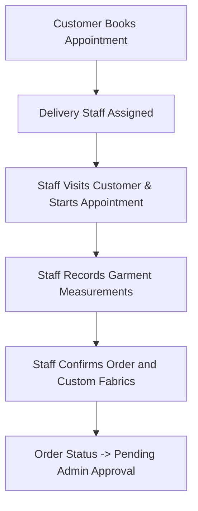

# Tailor Backend - Complete Developer & Learning Guide

Welcome to the Tailor Backend Developer & Learning Guide! This document is designed for developers—from complete beginners in programming to those starting out with Laravel—who want to understand, build, and optimize this exact backend application from scratch.

This system is a **tailoring management platform** featuring:
- **Customers**: Can register, book appointments, input measurements, check invoices, and pay online.
- **Delivery/Pickup Staff**: Visit customers, collect measurements/fabrics, upload images, and collect cash.
- **Tailors**: Accept assigned garment orders, track stitching tasks, and update progress.
- **Admin**: Oversee the entire workflow, manage roles/permissions, update settings, review cash settlements, audit transactions, and generate invoices.

---

## Table of Contents
1. [Section 1: Setup & Environment Configuration](#section-1-setup--environment-configuration)
2. [Section 2: Object-Oriented Programming (OOP) in Laravel](#section-2-object-oriented-programming-oop-in-laravel)
3. [Section 3: Database Architecture & Eloquent Relationships](#section-3-database-architecture--eloquent-relationships)
4. [Section 4: Unified API Design, Sanctum & Middleware](#section-4-unified-api-design-sanctum--middleware)
5. [Section 5: Key Business Modules Explained](#section-5-key-business-modules-explained)
6. [Section 6: Advanced Gateway & Library Integrations](#section-6-advanced-gateway--library-integrations)
7. [Section 7: Code Optimization & Best Practices](#section-7-code-optimization--best-practices)
8. [Section 8: Step-by-Step 10-Day Rebuild Checklist](#section-8-step-by-step-10-day-rebuild-checklist)

---

## Section 1: Setup & Environment Configuration

To build and run this application, you need to set up a PHP development environment.

### 1. Prerequisites
- **PHP 8.2+**: The core programming language.
- **Composer**: Dependency manager for PHP (similar to npm for Node.js).
- **MySQL (or MariaDB)**: The relational database where data is stored.
- **Git**: Version control to manage your codebase.

### 2. Initializing Laravel 12 from Scratch
To create a fresh Laravel application, run this command in your terminal:
```bash
composer create-project laravel/laravel tailor-backend
```
Then, navigate into the created directory:
```bash
cd tailor-backend
```

### 3. Key Directory Structures to Learn
- `app/Http/Controllers/`: Contains the controller classes that handle incoming API requests and return responses.
- `app/Models/`: OOP classes representing database tables.
- `app/Http/Middleware/`: Filter classes that intercept requests (e.g., verifying if the user is logged in or has an Admin role).
- `app/Enums/`: Classes defining fixed sets of options (e.g., statuses, user roles).
- `routes/api.php`: The list of API endpoints exposed to frontend web/mobile apps.
- `database/migrations/`: Code blueprints that define database tables, fields, and indexes.

### 4. Configuring the `.env` (Environment) File
Create a `.env` file in the root folder (copying from `.env.example`). This file stores secret credentials:
```ini
APP_NAME="Tailor Website Backend"
APP_ENV=local
APP_KEY=base64:YOUR_GENERATED_KEY_HERE
APP_DEBUG=true
APP_URL=http://localhost:8000

DB_CONNECTION=mysql
DB_HOST=127.0.0.1
DB_PORT=3306
DB_DATABASE=tailor_db
DB_USERNAME=root
DB_PASSWORD=your_password

# Payment Keys
RAZORPAY_KEY_ID=rzp_test_xxxxxx
RAZORPAY_KEY_SECRET=yyyyyyyyyyyy
```
Generate your unique `APP_KEY` by running:
```bash
php artisan key:generate
```

---

## Section 2: Object-Oriented Programming (OOP) in Laravel

Laravel is written strictly in OOP style. Understanding OOP is key to writing clean code rather than writing long, unstructured script files.

### 1. Classes & Objects
A **Class** is a blueprint, and an **Object** is an instance of that blueprint.
- Instead of writing procedural functions, we create objects representing things.
- For example, `App\Models\User.php` represents a user. When we run `$user = new User()`, we are creating a new `User` object.

### 2. Inheritance
Inheritance allows one class to inherit the attributes and methods of another.
- In `app/Models/User.php`:
  ```php
  namespace App\Models;

  use Illuminate\Foundation\Auth\User as Authenticatable;
  use Laravel\Sanctum\HasApiTokens;

  class User extends Authenticatable {
      use HasApiTokens; // Reusable trait
  }
  ```
  Here, `User` inherits a massive set of built-in functions (like `save()`, `delete()`, `find()`) from Laravel’s core `Authenticatable` and `Model` classes. You do not need to re-write database operations yourself!

### 3. Encapsulation
Encapsulation means restricting direct access to some of an object's components.
- In Laravel Models, we restrict which database columns can be written directly using the `$fillable` array. This prevents malicious API users from modifying fields they shouldn't (like `role` or `is_admin`):
  ```php
  protected $fillable = [
      'name',
      'email',
      'phone',
      'password',
  ];
  ```

### 4. Traits (Horizontal Reuse)
Inheritance only allows inheriting from **one** parent class. Traits allow you to share functions across multiple classes.
- Look at `app/Traits/ApiResponse.php`. It provides unified standard API responses:
  ```php
  namespace App\Traits;

  trait ApiResponse {
      protected function successResponse($data, $message = null, $code = 200) {
          return response()->json([
              'success' => true,
              'message' => $message,
              'data'    => $data
          ], $code);
      }
  }
  ```
  Any controller (e.g., `AuthController`, `OrderController`) can import this trait using `use ApiResponse;` and instantly call `$this->successResponse(...)`.

### 5. Dependency Injection
Instead of creating instances of objects manually using `new`, Laravel automatically injects dependent objects into your methods.
- In `AuthController.php`:
  ```php
  public function register(Request $request) {
      // Laravel automatically instantiates and injects the HTTP $request object!
  }
  ```

---

## Section 3: Database Architecture & Eloquent Relationships

The database is defined using **migrations** (code-based blueprints) so we don't have to manually create tables in phpMyAdmin.

### 1. Key Database Schemas
Here are the essential tables and what they store:
- `users`: Standard user credentials (name, email, phone, password, role).
- `cloth_categories`: Men's, women's, shirts, trousers, suits, etc.
- `garments`: Pre-configured clothing styles under a category (including standard pricing and dimensions).
- `designs`: Catalog designs that customers can select.
- `appointments`: Booking details when delivery staff visit customers to measure them.
- `orders`: Created when an appointment is finalized. Stores delivery dates, assignees, and overall pricing.
- `order_items`: Specific clothes ordered within a single order.
- `order_measurements`: The physical dimensions (e.g., chest, waist, length) captured for each garment.
- `invoices`: Invoice billing logs, advance amounts, GST settings, and status.
- `cash_settlements`: Audit logs for cash collections.

### 2. Defining PHP Enums
We use Enums to prevent typos and ensure only valid values are stored in the database.
- Look at `app/Enums/RoleEnum.php`:
  ```php
  namespace App\Enums;

  enum RoleEnum: string {
      case ADMIN = 'admin';
      case TAILOR = 'tailor';
      case CUSTOMER = 'customer';
      case DELIVERY_STAFF = 'delivery_staff';
  }
  ```

### 3. Eloquent Relationships (How Tables Connect)
Database tables link to each other using keys. Eloquent maps these relationships into simple methods.

- **One-to-One (hasOne / belongsTo)**
  A User has exactly one Profile.
  In `User.php`:
  ```php
  public function userProfile() {
      return $this->hasOne(UserProfile::class);
  }
  ```
  In `UserProfile.php`:
  ```php
  public function user() {
      return $this->belongsTo(User::class);
  }
  ```

- **One-to-Many (hasMany / belongsTo)**
  An Order can contain many Items.
  In `Order.php`:
  ```php
  public function items() {
      return $this->hasMany(OrderItem::class);
  }
  ```
  In `OrderItem.php`:
  ```php
  public function order() {
      return $this->belongsTo(Order::class);
  }
  ```

---

## Section 4: Unified API Design, Sanctum & Middleware

The backend behaves as a **RESTful API** returning JSON to frontend clients (like React/Vue web portals and Flutter/React Native mobile applications).

### 1. API Route Structure (`routes/api.php`)
We separate routes that are public from routes requiring login.
```php
// Public routes
Route::post('/register', [AuthController::class, 'register']);
Route::post('/login', [AuthController::class, 'login']);

// Authenticated routes (Requires Token)
Route::middleware('auth:sanctum')->group(function () {
    Route::post('/logout', [AuthController::class, 'logout']);
    Route::get('/me', [AuthController::class, 'me']);
    
    // Admin Only Routes
    Route::prefix('admin')->middleware('role:admin')->group(function () {
        Route::get('/dashboard', [AdminController::class, 'dashboard']);
        Route::apiResource('categories', ClothCategoryController::class);
    });
});
```

### 2. Custom Role-Based Authentication Middleware
We want to block Delivery Staff from loading Admin dashboard stats. We create a middleware called `RoleMiddleware`:
```php
namespace App\Http\Middleware;

use Closure;
use Illuminate\Support\Facades\Auth;
use App\Enums\RoleEnum;

class RoleMiddleware {
    public function handle($request, Closure $next, $role) {
        $user = Auth::user();
        if (!$user) {
            return response()->json(['message' => 'Unauthenticated'], 401);
        }

        // Convert string argument (e.g., 'admin') to the RoleEnum
        $requiredRole = RoleEnum::from($role);

        if ($user->role !== $requiredRole) {
            return response()->json(['message' => 'Forbidden'], 403);
        }

        return $next($request);
    }
}
```

---

## Section 5: Key Business Modules Explained

### 1. The Appointment Booking & Measurement Flow


- When the Delivery Staff visits a customer, they open their mobile app and record measurements.
- These measurements are sent via a POST request to `/staff/appointments/{id}/measurements`.
- The controller saves them into `order_measurements` table, associating them with the specific item.

### 2. The Billing & Cash Settlement Audit Flow
Since delivery staff collect cash on-site, we need strict tracking to make sure the cash actually reaches the shop owner (Admin).
1. **Cash Collection**: Delivery staff marks an invoice as paid via cash:
   - Route: `/staff/payments/collect-cash`
   - Action: Inserts a record in `cash_collections` marked as `pending_settlement`.
2. **Admin Settlement**: When the staff returns to the shop, the Admin receives the physical cash and clicks "Settle" on the Admin panel:
   - Route: `/admin/cash-settlements/settle`
   - Action: Changes cash collection status to `settled`, writes to `cash_settlements` ledger, and documents the transaction audit trail.

---

## Section 6: Advanced Gateway & Library Integrations

### 1. Razorpay Payment Gateway Integration
Instead of importing heavy SDKs, this application communicates directly with Razorpay's API using standard PHP Curl commands.

- **Step 1: Initiate Razorpay Order (Backend to Razorpay)**
  We request Razorpay to open an order with a specific amount (in paisa, e.g., ₹100.00 = 10000 paisa):
  ```php
  $ch = curl_init();
  curl_setopt($ch, CURLOPT_URL, 'https://api.razorpay.com/v1/orders');
  curl_setopt($ch, CURLOPT_RETURNTRANSFER, 1);
  curl_setopt($ch, CURLOPT_POST, 1);
  curl_setopt($ch, CURLOPT_POSTFIELDS, json_encode([
      'amount' => $amountInCents, // e.g. 50000 for Rs.500
      'currency' => 'INR',
      'receipt' => 'receipt_' . $orderId,
  ]));
  curl_setopt($ch, CURLOPT_USERPWD, $keyId . ':' . $keySecret); // Basic Authentication
  curl_setopt($ch, CURLOPT_HTTPHEADER, ['Content-Type: application/json']);
  
  $response = curl_exec($ch);
  $rzpOrder = json_decode($response, true);
  ```
  The generated `razorpay_order_id` is sent back to the mobile/frontend app to trigger the payment modal.

- **Step 2: Signature Verification (Verifying Payment Legitimacy)**
  When the payment completes, Razorpay returns a `razorpay_payment_id` and a cryptographic `razorpay_signature`. We verify it using HMAC SHA256 to ensure the user did not spoof the payment:
  ```php
  $expectedSignature = hash_hmac(
      'sha256',
      $razorpayOrderId . '|' . $razorpayPaymentId,
      $keySecret
  );

  if (hash_equals($expectedSignature, $razorpaySignature)) {
      // Securely update invoice status to 'paid' in DB
  } else {
      // Abort! Signature doesn't match, transaction was tampered
  }
  ```

### 2. PDF Invoice & Stitching Slip Generation
We generate PDF documents using the `barryvdh/laravel-dompdf` package.
- We design the invoice using HTML and CSS in a Blade template (e.g., `resources/views/pdf/invoice.blade.php`).
- Inside the Controller, we load the view with the order object data and stream it:
  ```php
  use Barryvdh\DomPDF\Facade\Pdf;

  public function downloadInvoice($id) {
      $invoice = Invoice::with(['order.items', 'user'])->findOrFail($id);
      
      // Load HTML template and pass data
      $pdf = Pdf::loadView('pdf.invoice', compact('invoice'));
      
      // Return as a downloadable streaming file response
      return $pdf->download('invoice_' . $invoice->invoice_number . '.pdf');
  }
  ```

---

## Section 7: Code Optimization & Best Practices

Writing code that "just works" is not enough. To build professional backend systems, you must optimize for speed and reliability.

### 1. Optimizing Database Queries: The N+1 Query Problem
The N+1 problem occurs when your code runs one query to fetch list items, and then runs additional database queries *inside a loop* to fetch related records.

#### ❌ Unoptimized (Bad Practice)
```php
// Runs 1 query to get 50 orders
$orders = Order::all(); 

foreach ($orders as $order) {
    // Runs 1 query per loop iteration to get customer profile!
    // Total queries: 1 + 50 = 51 queries. If database grows, it will crash.
    echo $order->user->name; 
}
```

####  Optimized (Eager Loading - Good Practice)
```php
// Runs only 2 queries: one for orders, one for users
$orders = Order::with('user')->get(); 

foreach ($orders as $order) {
    // Already loaded in memory! No extra queries run.
    echo $order->user->name; 
}
```

### 2. Protecting Database State: Database Transactions (`DB::transaction`)
If you write code that saves to multiple tables, and the second save fails (e.g., network error or server crash), you will have corrupted, orphaned records.
Transactions ensure that **all** writes succeed, or **none** do (rollback).

#### ❌ Unoptimized (Unsafe)
```php
$order = Order::create([...]);

// If server crashes here, the Order exists in database, but has no items! Corrupted state.
foreach ($items as $item) {
    OrderItem::create([...]);
}
```

####  Optimized (Atomic Operation - Safe)
```php
use Illuminate\Support\Facades\DB;

DB::transaction(function () use ($items) {
    $order = Order::create([...]);
    
    foreach ($items as $item) {
        OrderItem::create([...]);
    }
}); 
// If any loop item fails, the database rolls back and deletes the Order. No orphan records!
```

### 3. Database Indexes for Fast Searching
When querying fields inside `where()` clauses (like searching by phone or user role), database engines scan the entire table row-by-row.
Adding an index allows MySQL to look up entries instantly, like an index at the back of a book.
- In migrations, add index modifiers on look-up columns:
  ```php
  $table->string('phone')->index(); 
  $table->string('role')->index();
  ```

---

## Section 8: Step-by-Step 10-Day Rebuild Checklist

Follow this checklist to recreate this application step-by-step from scratch.

### 📅 Day 1: Project Setup & Git Configuration
- [ ] Initialize Laravel: `composer create-project laravel/laravel tailor-backend`
- [ ] Install Laravel Sanctum: `composer require laravel/sanctum`
- [ ] Create a local MySQL database (`tailor_db`).
- [ ] Setup your `.env` database parameters.
- [ ] Run initial migrations (`php artisan migrate`).

### 📅 Day 2: Enums & User Schema
- [ ] Create Enums under `app/Enums/`: `RoleEnum`, `OrderStatusEnum`, `AppointmentStatusEnum`, `InvoiceStatusEnum`.
- [ ] Modify `create_users_table` migration to include `phone`, `role` (index), and `status`.
- [ ] Create User Profile tables (`user_profiles`, `delivery_staff_profiles`, `tailor_profiles`).
- [ ] Define the Eloquent relationships in `User` model (`hasOne` profiles).

### 📅 Day 3: Catalog Setup (Categories, Designs, Garments)
- [ ] Create migrations for `cloth_categories`, `garments`, `designs`.
- [ ] Write Models with relationship properties (e.g., `ClothCategory hasMany Garments`).
- [ ] Write Seeder scripts (`CatalogSeeder`, `UserSeeder`) to pre-fill categories and default administrator accounts.
- [ ] Run `php artisan db:seed` to populate test data.

### 📅 Day 4: Unified API Response & Security Authentication
- [ ] Create the `ApiResponse` Trait under `app/Traits/ApiResponse.php`.
- [ ] Create `AuthController.php` with `register()` and `login()` methods.
- [ ] Implement OTP database mapping and verification flow.
- [ ] Return Sanctum Bearer tokens on successful validation.
- [ ] Write `RoleMiddleware.php` to restrict specific API routes based on roles.

### 📅 Day 5: Appointment Booking APIs
- [ ] Create `appointments` migration and model (Status tracker: pending, accepted, ongoing, completed).
- [ ] Build APIs for customers to request a home booking appointment.
- [ ] Build APIs for Delivery Staff to pull assigned appointments for the day (`/staff/appointments/today`).

### 📅 Day 6: Garment Measurement Logs
- [ ] Create the `measurement_fields` and `order_measurements` tables.
- [ ] Write controller actions for delivery staff to submit user measurements on-site.
- [ ] Write logic converting a completed appointment into a formal `Order` automatically.

### 📅 Day 7: Order Assignment & Processing
- [ ] Implement routes for Admins to view orders and assign order items to a specific Tailor.
- [ ] Build the Tailor Profile view showing assigned tailoring tasks.
- [ ] Write state transitions for Orders (Pending -> Stitching -> Ready -> Out for Delivery -> Delivered).

### 📅 Day 8: Invoice Generation & GST Setup
- [ ] Create `invoices` table migration.
- [ ] Write calculator logic that sums up item costs, subtracts advance paid, and computes GST using current values in `gst_settings`.
- [ ] Build invoicing download streams using the DOMPDF package.

### 📅 Day 9: Razorpay Payment Integration
- [ ] Setup API keys in `.env` and `config/services.php`.
- [ ] Write `initiatePayment` methods using CURL to communicate with Razorpay.
- [ ] Implement signature validation inside the verify route using `hash_hmac`.
- [ ] Audit transactions securely inside a `DB::transaction`.

### 📅 Day 10: Cash Settling & Final Review
- [ ] Build the cash collection route for delivery staff to accept cash on delivery.
- [ ] Implement Admin verification endpoint to audit pending cash collections and mark them as settled.
- [ ] Refactor codebase to use Eager Loading (`with()`) on all list views to prevent performance bottlenecks.

---

*Tip: Read each file's docstrings, and refer to Laravel's official documentation for additional details on individual Eloquent helpers.*
