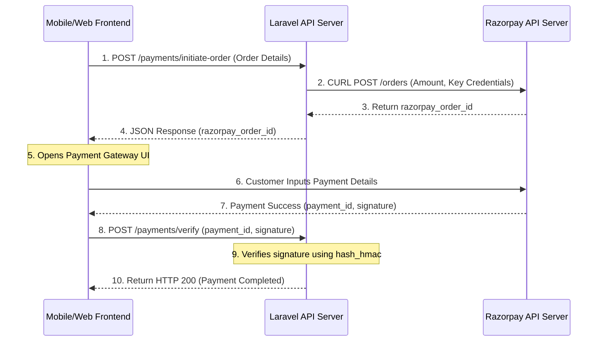

# Step-by-Step Module Construction Guide

This guide is a companion to the `DEVELOPER_LEARNING_GUIDE.md`. It provides the exact steps, file structures, and code logic sequences to construct the tailoring backend, module-by-module, from the simplest authentication module to the most advanced billing and payment modules.

---

## Table of Modules
1. [Module 1: Authentication & OTP System](#module-1-authentication--otp-system)
2. [Module 2: Product & Catalog Management](#module-2-product--catalog-management)
3. [Module 3: Appointment Booking (Customer Flow)](#module-3-appointment-booking-customer-flow)
4. [Module 4: Measurement Collection (Delivery Staff Flow)](#module-4-measurement-collection-delivery-staff-flow)
5. [Module 5: Order Processing & Tailor Assignment](#module-5-order-processing--tailor-assignment)
6. [Module 6: GST Config, Invoice & PDF Generation](#module-6-gst-config-invoice--pdf-generation)
7. [Module 7: Razorpay Payment Gateway Integration](#module-7-razorpay-payment-gateway-integration)
8. [Module 8: Cash Collection & Admin Audit Settlements](#module-8-cash-collection--admin-audit-settlements)

---

## Module 1: Authentication & OTP System

This is the entry point of your application. It handles user registration, password logins, role assignment, and one-time password (OTP) verification.

### Step 1: Create the User Roles Enum
Define who can access your system using a backing string PHP Enum.
- **File**: `app/Enums/RoleEnum.php`
- **Logic**:
  ```php
    namespace App\Enums;

  enum RoleEnum: string {
      case ADMIN = 'admin';
      case TAILOR = 'tailor';
      case CUSTOMER = 'customer';
      case DELIVERY_STAFF = 'delivery_staff';
  }
  ```

### Step 2: Set Up the Users Table Migration
We need columns for basic authentication, roles, and status checking.
- **File**: `database/migrations/xxxx_xx_xx_create_users_table.php`
- **Logic**:
  ```php
  Schema::create('users', function (Blueprint $table) {
      $table->id();
      $table->string('name');
      $table->string('email')->nullable()->unique();
      $table->string('phone')->unique();
      $table->timestamp('phone_verified_at')->nullable();
      $table->string('password');
      $table->string('role')->default('customer')->index(); // Maps to RoleEnum
      $table->string('status')->default('active'); // active, suspended
      $table->rememberToken();
      $table->timestamps();
  });
  ```

### Step 3: Create the OTP Database Table
To store OTP codes temporarily, create a table with an expiry column.
- **File**: `database/migrations/xxxx_xx_xx_create_otps_table.php`
- **Logic**:
  ```php
  Schema::create('otps', function (Blueprint $table) {
      $table->id();
      $table->string('email'); // Can store phone or email address
      $table->string('otp');
      $table->timestamp('expires_at');
      $table->timestamps();
  });
  ```

### Step 4: Write the Authentication Controller
Develop functions to handle registration, password checks, token generation, and OTP dispatch.
- **File**: `app/Http/Controllers/API/AuthController.php`
- **Flow**:
  1. **Register**: Validate input -> Create user in DB -> Set role to `customer` -> Generate 6-digit random number -> Save to `otps` table -> Trigger SMS/Email utility -> Return response indicating verification is required.
  2. **Verify OTP**: Locate the newest record matching the identifier in the `otps` table -> Ensure current time is less than `expires_at` -> Mark `phone_verified_at` inside `users` table -> Generate a Sanctum token: `$user->createToken('auth_token')->plainTextToken`.
  3. **Login**: Check credentials -> Validate status -> Issue Sanctum Token.

### Step 5: Create and Register Role Middleware
To protect APIs and ensure only specific roles (e.g., admin or tailor) can access certain routes:
1. **Create Middleware File**: `app/Http/Middleware/RoleMiddleware.php`
   ```php
   namespace App\Http\Middleware;

   use Closure;
   use Illuminate\Support\Facades\Auth;
   use App\Enums\RoleEnum;

   class RoleMiddleware
   {
       public function handle($request, Closure $next, $role)
       {
           $user = Auth::user();

           if (!$user) {
               return response()->json(['message' => 'Unauthenticated'], 401);
           }

           // Convert incoming route role parameter (e.g., 'admin') to the backing Enum
           $requiredRole = RoleEnum::from($role);

           if ($user->role !== $requiredRole) {
               return response()->json(['message' => 'Forbidden'], 403);
           }

           return $next($request);
       }
   }
   ```

2. **Register in Bootstrap**: `bootstrap/app.php`
   For Laravel 11/12, register the middleware inside the `$middleware->alias(...)` block:
   ```php
   ->withMiddleware(function (Middleware $middleware): void {
       $middleware->alias([
           'role' => \App\Http\Middleware\RoleMiddleware::class,
       ]);
   })
   ```

---


## Module 2: Product & Catalog Management

This module stores categories, clothing details (garments), and custom catalog designs that customers can select.

### Step 1: Migration Setup
You need three related tables:
- **Cloth Categories**: `categories` table (id, name, gender, status).
- **Garments**: `garments` table (id, category_id, name, base_price, secondary_price, image).
- **Designs**: `designs` table (id, name, garment_id, price, secondary_price, image, type).

### Step 2: Establish Eloquent Models
Map the database tables to models and define relations.
- **File**: `app/Models/ClothCategory.php`
  ```php
  public function garments() {
      return $this->hasMany(Garment::class, 'category_id');
  }
  ```
- **File**: `app/Models/Garment.php`
  ```php
  public function category() {
      return $this->belongsTo(ClothCategory::class);
  }
  
  public function designs() {
      return $this->hasMany(Design::class);
  }
  ```

### Step 3: Create Seeders for Test Data
Populate these tables so you can build and test APIs immediately.
- **File**: `database/seeders/CatalogSeeder.php`
- **Command to Run**: `php artisan db:seed --class=CatalogSeeder`

### Step 4: Write the Catalog API Controller
- **File**: `app/Http/Controllers/API/CatalogSystemController.php`
- **Endpoints**:
  - `GET /api/catalog`: Returns all active categories with their underlying garments.
  - `GET /api/catalog/categories/{id}/garments`: Returns garments filtering by category ID.

---

## Module 3: Appointment Booking (Customer Flow)

Customers use this module to request a home visit where delivery staff will measure them.

### Step 1: Create the Appointments Migration
- **File**: `database/migrations/xxxx_xx_xx_create_appointments_table.php`
- **Key Columns**:
  - `user_id`: Foreign key pointing to `users`.
  - `booking_date`: The selected date for the visit.
  - `booking_time`: The selected time slot.
  - `status`: Enum (pending, assigned, ongoing, completed, cancelled).
  - `address`: Detailed customer address location.
  - `assigned_staff_id`: Pointer to user with role `delivery_staff`.

### Step 2: Write API Endpoints for Booking
- **File**: `app/Http/Controllers/API/AppointmentController.php`
- **Flow**:
  1. Customer requests a booking, submitting `booking_date`, `time`, and `address`.
  2. The appointment is saved with status `pending`.
  3. Admin views all pending appointments (`GET /api/admin/appointments`) and updates the `assigned_staff_id` field to allocate a delivery staff member.

---

## Module 4: Measurement Collection (Delivery Staff Flow)

This is the mobile app workflow used by delivery staff on-site to document customer requirements.

### Step 1: Define Measurement Fields in DB
Instead of hardcoding size variables, we construct a table to dynamically store fields (e.g., chest, hip, sleeve, neck).
- **File**: `database/migrations/xxxx_xx_xx_create_measurement_fields_table.php`
  - Columns: `id`, `name`, `display_name`, `status`.
- **File**: `database/migrations/xxxx_xx_xx_create_order_measurements_table.php`
  - Columns: `id`, `order_item_id`, `measurement_field_id`, `value` (numeric dimension), `note` (text details).

### Step 2: Write the Measurement Recording API
When staff visits the customer:
1. They select the garments the customer wants.
2. They input the physical dimensions.
3. They make a POST request to `/api/staff/appointments/{id}/measurements` sending a JSON array of fields and values:
   ```json
   {
     "measurements": [
       {"field_id": 1, "value": "38.5"},
       {"field_id": 2, "value": "32.0"}
     ]
   }
   ```
4. **Action**: The controller loops and saves each record into the `order_measurements` table.

---

## Module 5: Order Processing & Tailor Assignment

Once measurements are completed, the appointment is finalized and converted into an official **Order**.

### Step 1: Create Order Conversion Logic
- **File**: `app/Http/Controllers/API/OrderController.php`
- **Flow**:
  ```php
  public function createFromAppointment($appointmentId) {
      return DB::transaction(function () use ($appointmentId) {
          $appointment = Appointment::findOrFail($appointmentId);
          
          // 1. Create parent Order record
          $order = Order::create([
              'user_id' => $appointment->user_id,
              'appointment_id' => $appointment->id,
              'status' => 'pending', // OrderStatusEnum
              'total_amount' => 0, // Calculated later
          ]);
          
          // 2. Clone appointment items to order_items
          // 3. Mark appointment as completed
          
          return $this->successResponse($order, 'Order created successfully');
      });
  }
  ```

### Step 2: Admin Tailor Assignment
Admins assign individual items inside the order to a specific Tailor.
- **Route**: `PUT /api/admin/orders/{orderId}/items/{itemId}/assign-tailor`
- **Action**: Updates the `assigned_tailor_id` in `order_items` table and fires a notification to the tailor.

---

## Module 6: GST Config, Invoice & PDF Generation

Calculates the billing amounts, handles tax math, and compiles invoice PDFs using HTML structures.

### Step 1: GST Database configuration
- **File**: `database/migrations/xxxx_xx_xx_create_gst_settings_table.php`
  - Columns: `id`, `cgst_rate`, `sgst_rate`, `status` (active).
- Inside `app/Http/Controllers/API/InvoiceController.php`, fetch the active GST percentages:
  ```php
  $gst = GstSetting::where('status', 'active')->first();
  $cgst = ($subtotal * $gst->cgst_rate) / 100;
  $sgst = ($subtotal * $gst->sgst_rate) / 100;
  $total = $subtotal + $cgst + $sgst;
  ```

### Step 2: Generate PDF
- Install DOMPDF: `composer require barryvdh/laravel-dompdf`
- Create a visual blade view: `resources/views/pdf/invoice.blade.php` (Using standard HTML table layouts).
- Load layout inside the controller and stream:
  ```php
  $pdf = Pdf::loadView('pdf.invoice', ['invoice' => $invoice]);
  return $pdf->download('invoice.pdf');
  ```

---

## Module 7: Razorpay Payment Gateway Integration

This module allows customers to pay online using credit/debit cards, UPI, or NetBanking securely.



### Step 1: Initiate Razorpay Order (Direct API Curl)
- **File**: `app/Http/Controllers/API/InvoiceController.php`
- **Logic**:
  ```php
  $amountInCents = $amount * 100; // Razorpay expects currency in smallest units
  
  $ch = curl_init('https://api.razorpay.com/v1/orders');
  curl_setopt($ch, CURLOPT_RETURNTRANSFER, true);
  curl_setopt($ch, CURLOPT_USERPWD, config('services.razorpay.key_id') . ':' . config('services.razorpay.key_secret'));
  curl_setopt($ch, CURLOPT_POST, true);
  curl_setopt($ch, CURLOPT_POSTFIELDS, json_encode([
      'amount' => $amountInCents,
      'currency' => 'INR',
      'receipt' => 'invoice_rcpt_' . $invoiceId
  ]));
  curl_setopt($ch, CURLOPT_HTTPHEADER, ['Content-Type: application/json']);
  
  $response = json_decode(curl_exec($ch), true);
  ```

### Step 2: Verification Action
Securely authenticate signature details before finalizing transaction logs:
```php
$expectedSignature = hash_hmac(
    'sha256', 
    $razorpayOrderId . '|' . $razorpayPaymentId, 
    config('services.razorpay.key_secret')
);

if (hash_equals($expectedSignature, $razorpaySignature)) {
    // Write transaction to DB: TransactionStatusEnum::SUCCESS
    // Update Invoice status to: InvoiceStatusEnum::PAID
}
```

---

## Module 8: Cash Collection & Admin Audit Settlements

Used to control and audit cash collection transactions.

### Step 1: Record Cash Collection (Delivery Staff)
When staff delivers the garment and receives physical money:
- **Route**: `POST /api/staff/payments/collect-cash`
- **Action**: Saves record in `cash_collections` table:
  ```php
  CashCollection::create([
      'delivery_staff_id' => Auth::id(),
      'invoice_id' => $request->invoice_id,
      'amount_collected' => $request->amount,
      'status' => 'pending_settlement',
  ]);
  ```

### Step 2: Settle Ledger Balance (Admin Audit)
When the delivery staff returns to the shop and hands the cash to the Admin:
- **Route**: `POST /api/admin/cash-settlements/settle`
- **Action**: Marks collection as settled, writes audit details to `payment_audit_logs`, and logs correction amounts if discrepancies occur.

---

*Tip: For any database write actions, wrap them inside `DB::transaction()` blocks to prevent orphan rows if errors occur mid-execution.*
